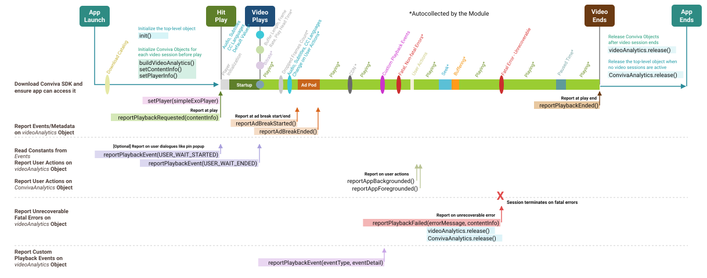
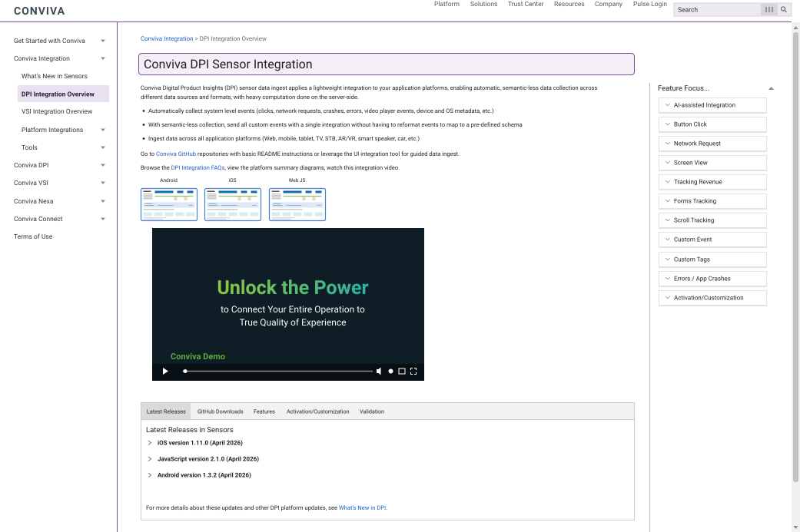

# Technical Writing & Product Strategy Portfolio

**Rich Slogar**

Samples of my work across product strategy, developer documentation, product documentation, and technical marketing content. Each sample opens as its own page, with a short note on its audience, purpose, and my role.

## Product Strategy

### [PLG Strategy for an Emerging Analytics Enterprise](plg-strategy.md)

A product-led growth strategy for an analytics provider squeezed between free tools and high-priced incumbents. It covers market positioning, counter-positioning against each competitor class, the activation and PQL design, a funnel-to-ARR model, and a 24-week execution plan with a go/no-go gate. *Capstone analysis, 2026.* · [Word version](plg-strategy-emerging-enterprise.docx)

## Developer Documentation

### [Bulk Filters API Guide](bulk-filters-api.md)

A case study of a task-based REST API guide that teaches administrators to view, create, modify, and delete saved filters in bulk. I wrote the guide from scratch, tested every request against the API, and reviewed it with subject-matter experts.

### [Android SDK Video Lifecycle Diagram](android-sdk-video-lifecycle.svg)

A single diagram that explains an Android SDK integration from app launch to app end: which metrics are collected automatically, and which SDK calls developers report at each stage of video playback. Built as an SVG, so every label is searchable text.

## Product Documentation

### [Explaining a Digital Intelligence Platform](digital-intelligence-platform.md)

A case study of an overview page that explains a real-time analytics platform, from client-side telemetry through metrics, AI alerts, and data APIs, for readers ranging from product managers to data engineers.

### [Feature Context Page](feature-context-page.svg)

A documentation page design that combines several learning modes in one place: overview text, platform summary diagrams, a demo video, current release notes, and a Feature Focus panel of use cases.

## Technical Marketing Content

### [DevOps, Meet Real-Time User Experience](devops-blog.md)

A product blog post that introduces app analytics features to DevOps teams, written with the product architect and product manager to support adoption from prospect to early user. *2023.*

### [TN320 Multi-Layer Networking](multilayer-networking-white-paper.md)

A technical white paper for telecom carriers on integrating packet and optical networks. It covers the capacity economics, GMPLS control-plane provisioning, protection switching, and service-level traffic engineering. *2008.*
