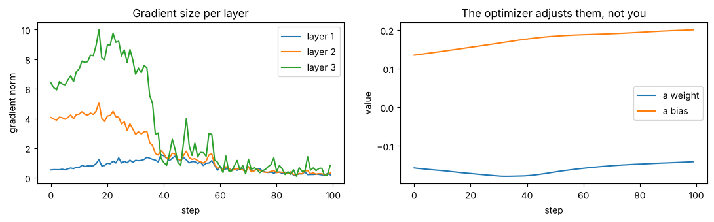
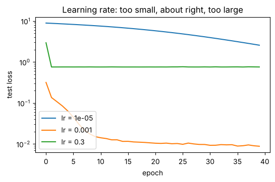
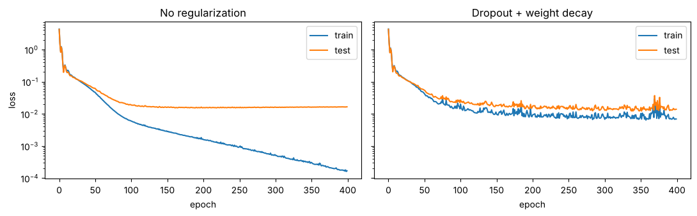

# Agent Throughput Predictor: Applying Basic Machine Learning

**TL;DR:** How to set up and run a PyTorch notebook that predicts AI agent throughput, simulate and compare workloads, check the model's validation results, tune its training, and fix common problems.

**Audience:** Agent developers, data analysts and agent system operators

**Reading time:** about 15 minutes for the full guide, or 10 minutes to run the project with the [Quick start](#quick-start)

**Project documents:** [Summary](SUMMARY.md): project overview · [README](README.md): steps to set up and run the project · [Technical notes](TECHNICAL_NOTES.md): details for data results, code design, and project glossary

The project presents a PyTorch neural network that uses six workload features (context length, tool calls, sub-agents, concurrent agents, cache hit rate and hardware tier) to predict how many **tokens per second** an AI agent generates, and determine *"How many agents can share the same hardware before each agent's throughput falls below 20 tokens/sec?"*.

> **About the data:** This project uses **simulated** agent sessions. The notebook's `simulate_sessions()` function uses PyTorch's random number generator to create 5,000 agent sessions (4,000 training sessions, 1,000 test sessions) from a formula that mimics how agent workloads behave. It adds about 8% random noise to each result so the data resembles real measurements. The focus is to demonstrate the use of PyTorch and a neural network setup process, not real hardware performance.


## Contents

- [Quick start](#quick-start)
- [What it does](#what-it-does)
- [Requirements](#requirements)
- [Set up the environment](#set-up-the-environment)
- [Run the notebook](#run-the-notebook)
- [Simulate and compare workloads](#simulate-and-compare-workloads)
- [Expected model validation results](#expected-model-validation-results)
- [Tune model training](#tune-model-training)
- [Troubleshooting](#troubleshooting)
- [Author's note](#authors-note)

## Quick start

For readers who already have [Anaconda](https://www.anaconda.com/download) and VS Code with the Python and Jupyter extensions. For detailed steps, or to use Jupyter Notebook in a browser, see [Set up the environment](#set-up-the-environment).

1. Download or clone the project, then open **Anaconda Prompt** (Windows) or a terminal (macOS, Linux) in the project folder.
2. Create the environment, install the requirements and register the notebook kernel:
   ```
   conda create -n pytorch python=3.12 -y
   conda activate pytorch
   pip install -r requirements.txt
   python -m ipykernel install --user --name pytorch --display-name "Python (PyTorch)"
   ```
3. In VS Code, open `agent_throughput_predictor.ipynb`.
4. Click **Select Kernel** and choose **Python (PyTorch)**.
5. Click **Run All**. The notebook takes one to two minutes on a CPU.

Your results should match [Expected model validation results](#expected-model-validation-results). If something goes wrong, see [Troubleshooting](#troubleshooting).

## What it does

AI agents reason in many steps, call tools, start sub-agents and share hardware with other agents. All of that affects how quickly each agent generates output. This model learns that relationship from 4,000 example sessions, then answers questions such as:

- *Will this agent meet a 20 tokens/sec target?*
- *How many agents can share this hardware before they slow below the target?*

To check that the model's predictions can be trusted, the notebook validates it on 1,000 test sessions held back from training, so the model is scored only on workloads it has never seen (see [Expected model validation results](#expected-model-validation-results)). If the accuracy isn't good enough, you can adjust the training settings and retrain, as described in [Tune model training](#tune-model-training).

**Inputs (features)**

| Feature | Meaning | Range |
| --- | --- | --- |
| `context_tokens` | Tokens the agent carries from turn to turn | 1,000 – 128,000 |
| `tool_calls` | Tool calls during the session | 0 – 20 |
| `subagents` | Sub-agents it starts | 0 – 5 |
| `concurrent_agents` | Agents sharing the same hardware | 1 – 64 |
| `cache_hit_rate` | Share of earlier work reused from cache | 0.0 – 0.95 |
| `hardware_tier` | 0 = small, 1 = medium, 2 = large | 0, 1, 2 |

**Output:** predicted tokens per second, plus a pass or fail against the 20 tokens/sec target (`SLO_TPS = 20`).

> **Note:** The 20 tokens/sec target is an example based on published benchmarks, which report results against service-level objectives of 20 and 60 tokens per second per agent. Teams adjust these targets based on speed and cost considerations. To change it, see [Token Output Rate Target](#token-output-rate-target).

## Requirements

- Windows, macOS or Linux
- Python 3.10 – 3.14 (Python 3.12 recommended)
- About 1 GB of free disk space for PyTorch
- No GPU needed. The notebook runs on a CPU in one to two minutes.
- An editor that runs Jupyter notebooks: VS Code with the Python and Jupyter extensions, or Jupyter Notebook in a browser

**Built with** [PyTorch](https://pytorch.org/) and [Matplotlib](https://matplotlib.org/). Installation steps follow the [PyTorch Get Started guide](https://pytorch.org/get-started/locally/).

## Set up the environment

These steps use Anaconda. If you already have a PyTorch environment, skip to step 4.

1. Get the project files. Either clone the repository with git, or download it as a ZIP file and unzip it.
2. Open **Anaconda Prompt** (Windows) or a terminal (macOS, Linux).
3. Create and activate an environment:
   ```
   conda create -n pytorch python=3.12 -y
   conda activate pytorch
   ```
4. Go to the project folder and install the requirements. This installs PyTorch, Matplotlib, Jupyter and ipykernel:
   ```
   cd path\to\agent-throughput-predictor
   pip install -r requirements.txt
   ```
5. Register the environment as a notebook kernel, so VS Code and Jupyter can find it:
   ```
   python -m ipykernel install --user --name pytorch --display-name "Python (PyTorch)"
   ```
6. Check the install:
   ```
   python -c "import torch; print(torch.__version__)"
   jupyter --version
   ```
   A PyTorch version number such as `2.14.1+cpu`, followed by a list of Jupyter components, means everything is ready.

### Set up a notebook editor

Choose one option.

**Option A: VS Code**

1. Install [VS Code](https://code.visualstudio.com/).
2. Open the Extensions view (**Ctrl+Shift+X**) and install the **Python** and **Jupyter** extensions from Microsoft.
3. Select **File** > **Open Folder** and open the project folder.

**Option B: Jupyter Notebook in a browser**

No extra installation is needed. Jupyter was installed in step 4.

## Run the notebook

**In VS Code**

1. Open `agent_throughput_predictor.ipynb`.
2. Click **Select Kernel** in the top-right corner and choose **Python (PyTorch)**.
3. Click **Run All** at the top of the notebook, or run each cell in order with **Shift+Enter**.

**In Jupyter Notebook**

1. In Anaconda Prompt, with the `pytorch` environment active, go to the project folder and start Jupyter:
   ```
   cd path\to\agent-throughput-predictor
   jupyter notebook
   ```

   Jupyter opens in your browser and lists the project files.

2. Click `agent_throughput_predictor.ipynb`.

3. Select **Kernel** > **Change Kernel** and choose **Python (PyTorch)**.

4. Select **Run** > **Run All Cells**, or run each cell in order with **Shift+Enter**.

5. When you finish, save the notebook, close the browser tab, and press **Ctrl+C** in Anaconda Prompt to stop Jupyter.

> **Tip:** Run the cells from top to bottom. Later cells use variables that earlier cells create. If you change an early cell, restart the kernel and run all cells again.

The notebook has ten sections:

| Section | What happens |
| --- | --- |
| 1. Generate data | Creates 5,000 simulated agent sessions |
| 2. Prepare data | Splits 80/20 into training and test sets, normalizes inputs, takes the log of the target |
| 3. Build the model | Defines `ThroughputNet`, a custom `nn.Module` with two hidden layers |
| 4. Train | Runs the training loop for 40 epochs and plots the loss |
| 5. Evaluate | Measures accuracy on the 1,000 test sessions, charts the distribution of errors, and shows a confusion matrix with precision, recall and F1 |
| 6. Workload simulation | Predicts throughput for any workload and plots capacity |
| 7. Tuning experiments | Compares learning rate, model size, optimizer and overfitting settings |
| 8. Look inside | Tracks gradients, a weight and a bias during training |
| 9. Save and reload | Saves the model and normalization values to `throughput_model.pt` |
| 10. Troubleshooting | Reproduces five common bugs on purpose, with fixes |

## Simulate and compare workloads

After you run sections 1 to 6, call `predict_tps()` in a new cell with any workload:

```python
predict_tps(context_tokens=64_000, tool_calls=8, subagents=2,
            concurrent_agents=32, cache_hit_rate=0.5, hardware_tier=1)
```

Output:

```
  18.9 tokens/sec  ->  MISSES target (20 tokens/sec)
```

To see the effect of each input, change one parameter per run and keep the others at their starting values. Then combine the changes in a final run:

| Run | Change from the starting workload | Predicted speed | Result |
| --- | --- | --- | --- |
| 1 | None (starting workload) | 18.9 tokens/sec | Misses target |
| 2 | `cache_hit_rate` raised from `0.5` to `0.9` | 25.4 tokens/sec | Meets target |
| 3 | `concurrent_agents` lowered from `32` to `8` | 40.9 tokens/sec | Meets target |
| 4 | Both changes from runs 2 and 3 | 53.8 tokens/sec | Meets target |

For example, run 2 changes only `cache_hit_rate`, from `0.5` to `0.9`:

```python
predict_tps(context_tokens=64_000, tool_calls=8, subagents=2,
            concurrent_agents=32,
            cache_hit_rate=0.9,    # changed from 0.5
            hardware_tier=1)
```

Runs 2 and 3 show that, for this workload, reducing sharing has a larger effect than improving cache reuse. Run 4 shows that the effects multiply when combined.

### Token Output Rate Target

To use a different token output rate target, change `SLO_TPS` in the Setup cell (section 0). For example, to test against the stricter 60 tokens/sec objective:

```python
SLO_TPS = 60.0                 # changed from 20.0
```

Then restart the kernel and run all cells again. The model's speed predictions don't change; only the pass or fail results and the capacity limits do.

## Expected model validation results

Your numbers based on the default constraints should match these closely, because the notebook fixes its random seeds. Small differences between PyTorch versions are normal.

| Measure | Result | What it means |
| --- | --- | --- |
| Final test loss | 0.0088 | Low error on unseen sessions |
| Median error | 6.0%* | Half of the predictions were within 6.0% of the actual speed; half were further off |
| R² (log scale) | 0.988 | The model explains about 98.8% of the variation in speed |
| SLO accuracy | 97.3% | Correct pass or fail call against the 20 tokens/sec target (the service-level objective, or SLO) on 973 of 1,000 test sessions |
| Precision | 95.9% | Of the sessions predicted to meet the target, the share that did |
| Recall | 98.5% | Of the sessions that met the target, the share the model caught |
| F1 score | 97.2% | A single score balancing precision and recall |

\* The median describes only the middle prediction. For the full range of errors, see [Distribution of prediction errors](TECHNICAL_NOTES.md#distribution-of-prediction-errors) in the technical notes.

Section 5 also shows a **confusion matrix** of the pass or fail calls on the test set:

| | Actually meets target | Actually misses target |
| --- | --- | --- |
| **Predicted to meet** | 465 (true positives) | 20 (false positives, or false passes) |
| **Predicted to miss** | 7 (false negatives) | 508 (true negatives) |

The same measures on the training set are nearly identical (precision 96.9%, recall 97.8%, F1 97.4%), which shows the model is not overfitting. See [Confusion matrix: precision, recall and F1](TECHNICAL_NOTES.md#confusion-matrix-precision-recall-and-f1) for what each measure means.

For the heavy workload in the capacity chart (96,000 context tokens, 10 tool calls, 2 sub-agents, 50% cache hits), the model predicts:

| Hardware | Meets the 20 tokens/sec target with up to |
| --- | --- |
| Small | 0 agents (cannot meet it even alone) |
| Medium | 19 concurrent agents |
| Large | 61 concurrent agents |

## Tune model training

Model training happens at two levels, and you control only one of them:

- **[Automated training](#automated-training)** adjusts the model's **parameters**, its 4,673 weights and biases. Training does this on its own; you never set these values.
- **[Hyperparameters](#hyperparameters)** are the settings that control how that training happens, such as the learning rate and the number of hidden units. These are the only values you change.

### Automated training

Each training step repeats the same four actions on a mini-batch of 64 sessions:

1. **Predict.** The model runs the sessions through its layers and predicts the log of tokens per second for each one.
2. **Measure the loss.** The loss function (mean squared error) compares the predictions with the actual log speeds and returns one number that scores how wrong they are.
3. **Compute the gradients.** `loss.backward()` works backward through the network and calculates a gradient for every weight and bias. A gradient says which direction to move that value, and how strongly, to reduce the loss.
4. **Update the weights and biases.** `optimizer.step()` moves each value a small step against its gradient. The **learning rate** sets the size of that step. `optimizer.zero_grad()` then clears the gradients so the next step starts fresh.

One pass through all 4,000 training sessions is an **epoch**, about 63 steps. The default run trains for 40 epochs, roughly 2,500 updates in total. With each update the loss shrinks a little, until it levels off.

The **optimizer** decides exactly how each step is taken:

- **SGD** (stochastic gradient descent) moves every weight by the learning rate times its gradient.
- **Adam** adapts the step size for each weight, based on that weight's recent gradients. It takes larger steps where progress is steady and smaller ones where gradients jump around, so it usually needs less tuning.

The goal is not the lowest *training* loss. It is the lowest loss on the **test set**, data the model never sees during training, because that shows how well it will predict new workloads.

#### Watch the optimizer work

Section 8 records the gradient size for each layer over 100 training steps, and follows one weight and one bias as the optimizer adjusts them. Gradients start large and settle as the model learns:

| Layer | Gradient size at step 0 | At step 99 |
| --- | --- | --- |
| 1 | 0.535 | 0.203 |
| 2 | 4.074 | 0.317 |
| 3 | 6.409 | 0.849 |

- **Healthy:** gradients shrink and level off.
- **Stalled:** gradients near zero from the start. Try a higher learning rate or check that inputs are normalized.
- **Unstable:** gradients grow step after step. Lower the learning rate.



### Hyperparameters

Hyperparameters are set before training starts and stay fixed while it runs. Choosing and adjusting them improves how accurately the model predicts agent throughput.

> **Tip:** Change one setting at a time and compare the final test loss. Changing several settings at the same time obscures individual setting impacts. 

#### The settings you can change

All settings are arguments to `train_model()`, so each experiment is one line:

```python
model, history = train_model(lr=1e-3, epochs=40, hidden=64)
```

The settings and when to adjust them:

| Setting | Argument | Default | What it controls | Raise it when | Lower it when |
| --- | --- | --- | --- | --- | --- |
| Learning rate | `lr` | `1e-3` | Size of each weight update | Loss falls very slowly | Loss jumps around or becomes `nan` |
| Epochs | `epochs` | `40` | Passes over the training data | Test loss is still falling at the end | Test loss rises while training loss falls |
| Batch size | `batch_size` | `64` | Sessions per update | Training is noisy | Training is slow to improve |
| Hidden units | `hidden` | `64` | How much the model can learn | Both losses stay high | Training loss is far below test loss |
| Optimizer | `optimizer_name` | `"adam"` | Strategy for updating weights | — | — |
| Dropout | `dropout` | `0.0` | Neurons switched off at random during training | The model overfits | Both losses stay high |
| Weight decay | `weight_decay` | `0.0` | Penalty on large weights | The model overfits | Both losses stay high |

Where `train_model()` appears in the notebook:

| Location | What it does | How to change a setting |
| --- | --- | --- |
| Section 4, Train (first code cell) | Defines `train_model()` and its default values in the first line, `def train_model(hidden=64, dropout=0.0, lr=1e-3, ...)`. The last line of the cell, `model, history = train_model()`, trains the main model with those defaults | Add arguments to that last line, for example `train_model(lr=1e-2)`, then rerun section 4 and the cells after it |
| Section 7, Tuning experiments (code cells 7a to 7d) | Calls `train_model()` with different settings for each experiment | Edit the values in the experiment cell and rerun it |
| A new cell after section 4 | Runs your own experiment without changing the main model | Add a cell with a line such as `test_model, h = train_model(hidden=128)` and compare `h["test"][-1]` with the default |

> **Note:** Changing the default values in the `def train_model(...)` line affects every later call, including the experiments in section 7. To keep the experiments comparable, pass new values as arguments instead.

#### What the experiments show

**Learning rate** (section 7a). The default is about right:

| Learning rate | Final test loss | Result |
| --- | --- | --- |
| 0.00001 | 2.5623 | Too small: barely learns in 40 epochs |
| 0.001 | 0.0088 | About right |
| 0.3 | 0.7538 | Too large: overshoots and never settles |



**Model size** (section 7b). Accuracy improves up to 64 hidden units, then levels off. A network four times larger adds no benefit:

| Hidden units | Weights and biases | Final test loss |
| --- | --- | --- |
| 4 | 53 | 0.0243 |
| 16 | 401 | 0.0120 |
| 64 | 4,673 | 0.0088 |
| 256 | 67,841 | 0.0090 |

**Optimizer** (section 7c). `SGD` and `Adam` are interchangeable; the training loop doesn't change. Adam reaches a lower loss (0.0088) than SGD (0.0123) with less tuning.

**Overfitting** (section 7d). Overfitting happens when a model too closely learns the details and noise of its training data, instead of considering the variations in that data that support a more general pattern. The model performs exceptionally well on its training data but fails to generalize to new data it hasn't seen, like a student who memorizes practice-test answers instead of learning the subject.

- **How to spot it:** training loss keeps falling while test loss stops improving or rises. The growing gap between the two is the warning sign.
- **What causes it:** too little data, a model with more capacity than the problem needs, or training for too many epochs.
- **How to fix it:** add more data, use **regularization** (dropout or weight decay), use a smaller model, or stop training earlier.

The experiment trains a large network (256 hidden units) on only 150 sessions for 400 epochs. The model memorizes them: training loss falls to almost zero while test loss stalls. Regularization narrows the gap, and more data closes it:

| Setup | Train loss | Test loss | Gap |
| --- | --- | --- | --- |
| 150 sessions, no fix | 0.0002 | 0.0165 | 0.0163 |
| 150 sessions + dropout 0.1 and weight decay 0.01 | 0.0069 | 0.0138 | 0.0070 |
| 4,000 sessions | 0.0072 | 0.0088 | 0.0016 |



## Troubleshooting

The rows labeled Bug 1 to Bug 5 match the five bugs that section 10 of the notebook reproduces on purpose, so you can see each symptom. The other rows cover setup and editor problems.

| Symptom | Likely cause | Fix |
| --- | --- | --- |
| `ModuleNotFoundError: No module named 'torch'` | The notebook uses a kernel without PyTorch | Select the **Python (PyTorch)** kernel: in VS Code, **Select Kernel** at the top right; in Jupyter, **Kernel** > **Change Kernel** |
| **Python (PyTorch)** doesn't appear in the kernel list | Setup step 5 was skipped, or the editor needs a reload | Rerun setup step 5, then reload VS Code or refresh the Jupyter page |
| `'jupyter' is not recognized` | The `pytorch` environment isn't active | Run `conda activate pytorch`, then start Jupyter again |
| `AttributeError: partially initialized module 'torch'` | An import was interrupted, for example by stopping a debug run | Restart the kernel, then run all cells |
| A cell shows a yellow highlighted line and no output (VS Code) | The cell was started in debug mode | Stop debugging (Shift+F5), then run with Shift+Enter |
| `NameError: name 'X_train' is not defined` | Cells were run out of order | Restart the kernel, then run all cells |
| **Bug 1:** Loss stays high (about 3.7 instead of 0.007) | Inputs are not normalized | Pass inputs through `normalize()` before training |
| **Bug 2:** Loss falls far less than expected or bounces | `optimizer.zero_grad()` is missing, so gradients pile up | Call `optimizer.zero_grad()` before `loss.backward()` every step |
| **Bug 3:** `UserWarning: Using a target size ... different to the input size` | Predictions are shape `[N, 1]` but targets are `[N]` | Reshape targets with `.unsqueeze(1)`; print `.shape` to check |
| **Bug 4:** Loss becomes `nan` or `inf` | Learning rate far too high | Lower `lr` by 10× and train again |
| **Bug 5:** A prediction is `inf` or wildly wrong although the model tested well | New inputs skipped normalization | Use `predict_tps()`, which normalizes for you |
| Results differ slightly from this guide | Different PyTorch version or hardware | Small differences are normal |

**For Bug 2,** this is what the notebook prints when it trains the same model with and without `zero_grad()`:

```
step   0   with zero_grad 10.3018   without 10.3018
step 100   with zero_grad 0.0931   without 0.7364
step 200   with zero_grad 0.0555   without 0.4200
step 299   with zero_grad 0.0365   without 0.8785
```

> **Tip:** When a training run behaves strangely, check three things first: the loss curve, the shapes of your tensors (`print(x.shape)`), and whether inputs are normalized.

## Author's note

This project was created in collaboration with Anthropic's Claude AI assistant. I defined the project scope and direction, refined the workload inputs and training settings, reviewed the results and reproduced them by running the notebook on my own machine, and revised the text of the summary, README and technical notes. Claude co-wrote the notebook code, including the simulated data formula, and drafted the initial text.

AI-assisted code and content can contain errors or imprecise wording. The results reported here come from running the notebook, and readers can reproduce them by running it themselves. Please verify any detail before relying on it.
