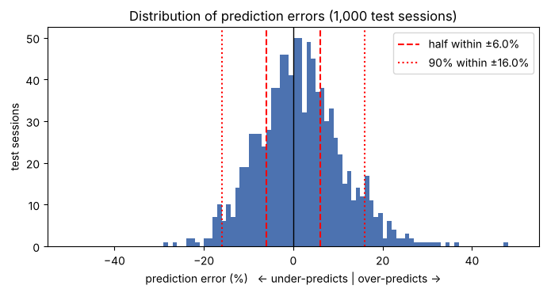
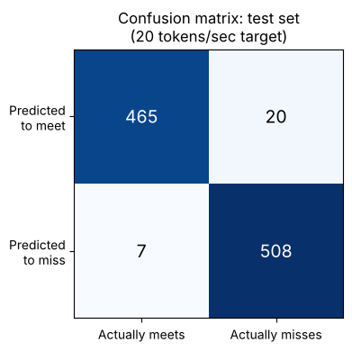

# Agent Throughput Predictor: Technical Notes

**TL;DR:** The model design, code structure and reference, glossary and detailed test results behind the Agent Throughput Predictor, plus a plan for taking the model into a live AI agent ecosystem.

**Audience:** Engineers, technical reviewers and readers who want the full detail

**Reading time:** about 15 minutes

**Project documents:** [Summary](SUMMARY.md): project overview · [README](README.md): steps to set up and run the project · [Technical notes](TECHNICAL_NOTES.md): details for data results, code design, and project glossary

## Contents

- [Model design and training](#model-design-and-training)
- [Code structure](#code-structure)
- [Code reference](#code-reference)
- [Glossary](#glossary)
- [Detailed test results](#detailed-test-results)
- [Simulated data and hardware tiers](#simulated-data-and-hardware-tiers)
- [From notebook to production](#from-notebook-to-production)
- [Author's note](#authors-note)

## Model design and training

1. **Data preparation:** split the data into training and test sets, and normalized the inputs. The model also predicts the logarithm of tokens per second instead of the raw value, then converts back with `exp()` for reporting. Two reasons:
    - Each workload factor multiplies speed up or down (for example, base speed × context effect × sharing effect). A logarithm turns those multiplications into additions, a simpler pattern for the network to learn.
    - Speeds range from about 2 to nearly 300 tokens/sec. On the raw scale, errors on fast sessions would dominate training. On the log scale, errors count as percentages, so a 10% miss weighs the same for a slow session as a fast one.
2. **Model:** `ThroughputNet`, a custom subclass of PyTorch's `nn.Module`. The subclass defines two things:
    - **The layers** (in `__init__`): six inputs feed a hidden layer of 64 neurons, then a second hidden layer of 64, then one output, the predicted log of tokens per second. A ReLU activation between layers lets the network learn curved relationships, not just straight lines. Optional dropout guards against overfitting.
    - **The computation** (in `forward()`): how an input flows through those layers to a prediction.

    By inheriting from `nn.Module`, the class gets the rest of the machinery without extra code: it tracks all 4,673 trainable weights and biases for the optimizer, runs `forward()` when called as `model(x)`, switches dropout on for training and off for evaluation, and saves or reloads its weights.
3. **Training and evaluation:** a mini-batch training loop with the Adam optimizer, judged only on unseen data.
4. **Tuning experiments:** controlled experiments on learning rate, model size, optimizer choice and overfitting, each changing one setting.
5. **Troubleshooting:** reproduced five common training bugs on purpose and documented each symptom, cause and fix.

## Code structure

The project combines PyTorch's object-oriented classes with a few plain functions that run the workflow. Two kinds of relationship connect the classes.

**Inheritance ("is a").** Every layer, the loss function and the model itself are subclasses of `nn.Module`, so they share one interface: each is called like a function, which runs its own `forward()`. Both optimizers are subclasses of `torch.optim.Optimizer` and share the methods `step()` and `zero_grad()`.

```
nn.Module                          torch.optim.Optimizer
├── ThroughputNet  (this project)  ├── torch.optim.Adam
├── nn.Sequential                  └── torch.optim.SGD
├── nn.Linear
├── nn.ReLU
├── nn.Dropout
└── nn.MSELoss
```

**Composition ("has a").** A `ThroughputNet` object holds an `nn.Sequential` container in its `layers` attribute, which in turn holds the individual layer objects. The weights and biases live inside the three `nn.Linear` objects.

```
ThroughputNet
└── layers: nn.Sequential
    ├── nn.Linear(6, 64)    ← weights and biases
    ├── nn.ReLU
    ├── nn.Dropout
    ├── nn.Linear(64, 64)   ← weights and biases
    ├── nn.ReLU
    ├── nn.Dropout
    └── nn.Linear(64, 1)    ← weights and biases
```

**Object-oriented concepts in this project**

| Concept | Where it appears |
| --- | --- |
| Class and object (instance) | `ThroughputNet` is a class, a blueprint. Each call to `train_model()` creates a new, separate object from it with `ThroughputNet(hidden=..., dropout=...)`, which is why the experiments can train several models side by side without affecting each other |
| Constructor (`__init__()`) | `ThroughputNet.__init__()` runs when an object is created. Its arguments (`n_features`, `hidden`, `dropout`) set the size of the layers, so one class can build models of different sizes |
| `super().__init__()` | The first line of `ThroughputNet.__init__()`. Runs the parent `nn.Module` constructor, which sets up the machinery that registers the layers and their weights. Without it, PyTorch could not find the model's parameters |
| Inheritance | `ThroughputNet` inherits from `nn.Module`, so it gets `parameters()`, `train()`, `eval()`, `state_dict()` and `load_state_dict()` without writing them |
| Method overriding | `nn.Module` defines `forward()` as a placeholder that must be replaced. `ThroughputNet`, `nn.Linear`, `nn.ReLU` and `nn.MSELoss` each override it with their own computation |
| `__call__()` (a "magic" method) | Writing `model(x)` makes Python run `model.__call__(x)`, which `nn.Module` defines to run housekeeping and then call `self.forward(x)`. The parent controls the steps; each subclass supplies its own `forward()` |
| Polymorphism | Code that calls the same method on different classes gets each class's own behavior. `loss_fn(pred, y)` and `model(x)` use the same calling style for very different jobs. In `train_model()`, the optimizer can be `Adam` or `SGD`, and the loop calls `opt.zero_grad()` and `opt.step()` without knowing which one it has |
| Composition | `ThroughputNet` is built from smaller objects rather than inheriting from them. It has an `nn.Sequential`, which has the layers. Changing the network means changing which objects it holds, not its parent class |
| Encapsulation | Each object keeps its own data. The weights and biases stay inside each `nn.Linear` object, and `model.parameters()` collects them on request, so the optimizer never needs to know how the model is built inside |
| Functions vs. methods | `simulate_sessions()`, `normalize()`, `train_model()`, `evaluate()`, `pass_fail_counts()`, `pass_fail_metrics()` and `predict_tps()` are plain functions that run steps of the workflow. `forward()`, `step()` and `eval()` are methods that belong to an object and act on its own data |

## Code reference

The classes and functions used in this project, and what each one does here. Values in parentheses are this project's settings.

### Project classes and functions

Defined in the notebook for this project.

| Name | What it does |
| --- | --- |
| `evaluate()` | Runs the trained model on the 1,000 test sessions and returns the median error, R² and pass or fail accuracy |
| `pass_fail_counts()` | Converts a model's speed predictions into pass or fail calls against `SLO_TPS` and counts the four confusion matrix outcomes: true and false positives, false and true negatives. Works with any `ThroughputNet` object and any data set, which is how it compares the training and test sets |
| `pass_fail_metrics()` | Calculates precision, recall, F1 score and accuracy from the four counts returned by `pass_fail_counts()` |
| `normalize()` | Rescales each workload input using the mean and standard deviation of the training set, so no single input dominates training |
| `predict_tps()` | Predicts tokens per second for one workload from its six inputs, applies `normalize()` first, and reports whether the prediction meets the 20 tokens/sec target. Takes an optional `net` argument, so the same function works with any `ThroughputNet` object, such as the reloaded model in section 9 |
| `simulate_sessions()` | Generates the simulated agent sessions (5,000) from a formula with about 8% random noise |
| `ThroughputNet` | The model class: a subclass of `nn.Module` with six inputs, two hidden layers of 64 neurons and one output, the predicted log of tokens per second. Defines only two methods, `__init__()` to build its layers and `forward()` to run them, and inherits everything else |
| `train_model()` | Creates and trains a new `ThroughputNet` object. Its arguments are the hyperparameters (learning rate, epochs, batch size, hidden units, optimizer, dropout, weight decay). Chooses an `Adam` or `SGD` object from `optimizer_name`, then runs the same training loop for either. Returns the trained object and its loss history |

### PyTorch classes and functions

From the PyTorch library, as used in this project.

| Name | What it does here |
| --- | --- |
| `forward()` | The `ThroughputNet` method that passes an input through `self.layers` to produce a prediction. It overrides the placeholder in `nn.Module` and runs automatically, through the inherited `__call__()`, when the model is called as `model(x)` |
| `loss.backward()` | Calculates the gradient for every weight and bias from the current loss |
| `model.train()`, `model.eval()` | Switch the model between training mode (dropout on) and evaluation mode (dropout off) |
| `nn.Dropout` | Randomly switches off a share of neurons during training to reduce overfitting (0.0 by default; 0.1 in the overfitting experiment) |
| `nn.Linear` | A subclass of `nn.Module`: a fully connected layer whose `forward()` multiplies its inputs by its weights and adds its bias. `ThroughputNet` holds three, and each stores its own weights and biases |
| `nn.Module` | PyTorch's parent class for every model, layer and loss function. Provides `__call__()`, `parameters()`, `train()`, `eval()` and `state_dict()` to all its subclasses, and requires each to supply its own `forward()` |
| `nn.MSELoss` | The loss function: the average squared difference between predicted and actual log tokens per second. Also a subclass of `nn.Module`, so it is created as an object (`loss_fn = nn.MSELoss()`) and called like the model (`loss_fn(pred, y)`) |
| `nn.ReLU` | The activation between layers. Passes positive values through and turns negative values into zero, so the model can learn curved relationships |
| `nn.Sequential` | A container subclass of `nn.Module` that holds the layers of `ThroughputNet` and whose `forward()` runs them in order. Lets `ThroughputNet.forward()` be one line: `return self.layers(x)` |
| `optimizer.step()` | Moves every weight and bias a small step against its gradient |
| `optimizer.zero_grad()` | Clears the previous step's gradients. Without it, gradients add up across steps (troubleshooting bug 2) |
| `torch.exp()`, `torch.log()` | Convert between tokens per second and its logarithm. The model trains on the log and reports results with `exp()` |
| `torch.manual_seed()` | Fixes the random number generator so every run produces the same data and results |
| `torch.no_grad()` | Turns off gradient tracking when the model only makes predictions, as in evaluation and `predict_tps()` |
| `torch.optim.Adam` | The default optimizer, a subclass of `torch.optim.Optimizer`. Adapts the step size for each weight (learning rate 0.001). Created with `Adam(net.parameters(), lr=...)`, so it receives the model's weights and biases without knowing the model's structure |
| `torch.optim.SGD` | Stochastic gradient descent, also a subclass of `torch.optim.Optimizer`: the alternative optimizer compared in the experiments. Moves every weight by the learning rate times its gradient. Interchangeable with `Adam` because both provide the same `step()` and `zero_grad()` methods |
| `torch.save()`, `torch.load()`, `state_dict()` | Save the trained weights and normalization values to `throughput_model.pt` and reload them |

## Glossary

The machine learning terms used in this project, as they apply here. Values in parentheses are this project's settings or results.

| Term | Meaning in this project |
| --- | --- |
| Epoch | One full pass through the training set. Each epoch is about 63 mini-batch steps (4,000 sessions ÷ 64), and the default run trains for 40 epochs, roughly 2,500 updates |
| Confusion matrix | A table of the four possible outcomes of the pass or fail calls: true positives (465), false positives (20), false negatives (7) and true negatives (508) on the test set |
| F1 score | The harmonic mean of precision and recall, high only when both are high (97.2% on the test set) |
| False pass | A false positive: a test session the model predicted would meet the 20 tokens/sec target but actually missed it (20 of the 27 incorrect calls) |
| Feature (workload input) | One of the six model inputs: context tokens, tool calls, sub-agents, concurrent agents, cache hit rate and hardware tier |
| Gradient | For each weight or bias, the direction and amount it should change to reduce the loss. Calculated by `loss.backward()` |
| Hidden layer | A layer between the inputs and the output. `ThroughputNet` has two, each with 64 neurons |
| Hyperparameter | A training setting chosen before training, such as the learning rate or number of hidden units. Set through `train_model()` arguments |
| Learning rate | The size of each weight update (0.001 by default) |
| Logarithm (log) | The model predicts the log of tokens per second, which turns multiplying workload effects into additions and makes errors count as percentages |
| Loss | One number scoring how wrong the predictions are, measured by `nn.MSELoss` (final test loss 0.0088) |
| Median error | The middle value of all test errors: half are smaller, half larger (6.0%) |
| Mini-batch | The group of training sessions used for each update (64) |
| Neuron | One unit in a layer that combines its inputs with weights and a bias |
| Noise | Random variation added to the simulated speeds (about 8%), so no model can reach zero error |
| Overfitting | When the model learns the details and noise of its training data too closely, instead of the general pattern, so it performs well on that data but fails to generalize to new data. Shown by training on only 150 sessions in experiment 7d |
| Precision | Of the sessions the model predicted would meet the target, the share that actually did (95.9% on the test set) |
| Prediction bias | A consistent lean in the errors. The model's average error of +1.5% means it slightly over-predicts speed |
| R² (R-squared) | The share of variation in test speeds the model explains (0.988). Measures fit, not statistical significance |
| Recall | Of the sessions that actually met the target, the share the model predicted would (98.5% on the test set) |
| Regularization | Methods that reduce overfitting. This project uses dropout and weight decay, a penalty on large weights |
| Service-level objective (SLO) | The speed target each agent should meet: 20 tokens per second (`SLO_TPS`) |
| Standard deviation | How spread out values are around their average. Used by `normalize()`, and to describe the spread of test errors (9.5%) |
| Tensor | PyTorch's data type for grids of numbers. The inputs are a 5,000 × 6 tensor, one row per session |
| Test set | The 1,000 sessions held back from training and used only to measure accuracy |
| Throughput | Tokens per second produced by one agent, the value the model predicts |
| Token | A chunk of text, often part of a word, that an AI agent's language model reads or writes |
| Training | The repeated loop of predicting, measuring the loss, calculating gradients and updating weights and biases |
| Training set | The 4,000 sessions the model learns from |
| Weights and biases | The model's learned values (4,673 in total), adjusted automatically during training |

## Detailed test results

All results come from the 1,000 test sessions held back from training. The [summary](SUMMARY.md#results) gives the headline numbers; this section explains them.

### Distribution of prediction errors

The median error (6.0%) describes only the middle prediction. The chart shows the error for every one of the 1,000 test predictions. Positive errors mean the model over-predicted speed; negative errors mean it under-predicted.

The chart shows the error for every one of the 1,000 test predictions. Positive errors mean the model over-predicted speed; negative errors mean it under-predicted.



| Share of predictions | Error within |
| --- | --- |
| 25% | 2.8% |
| 50% (median) | 6.0% |
| 75% | 10.3% |
| 90% | 16.0% |
| 95% | 18.4% |
| 100% (largest single error) | 47.3% |

- **Spread:** errors have a standard deviation of 9.5%. Most predictions are close, with a thin tail of larger misses.
- **Bias:** errors center slightly above zero, with an average of +1.5%. The model over-predicted speed in 555 sessions and under-predicted in 445, so it leans slightly optimistic.
- **Noise floor:** the simulated data includes about 8% random noise, so no model could reach zero error. A 6% median is close to the best achievable.

### About R²

R² measures how well the model fits, not statistical significance. It is not a p-value, so a threshold such as 0.05 does not apply. Values closer to 1.0 mean a better fit.

### About the pass or fail result

The 97.3% measures the model's reliability, not agent performance: only 472 of the 1,000 test sessions actually met the target. All 27 incorrect calls were borderline sessions running between 17.7 and 23.0 tokens/sec. Of these, 20 were false passes, where the model predicted a session would meet the target but it did not, consistent with its slight tendency to over-predict speed. Because a false pass lets a slow agent through, operators should plan with a safety margin above the target.

### Confusion matrix: precision, recall and F1

A confusion matrix breaks the pass or fail calls into four outcomes, treating "meets target" as the positive result. On the 1,000 test sessions:



| | Actually meets target | Actually misses target |
| --- | --- | --- |
| **Predicted to meet** | 465 (true positives) | 20 (false positives, or false passes) |
| **Predicted to miss** | 7 (false negatives) | 508 (true negatives) |

Three measures come from these counts:

- **Precision (95.9%):** of the 485 sessions the model said would pass, 465 did. Precision matters most to operators, because each false positive lets a slow agent through.
- **Recall (98.5%):** of the 472 sessions that actually passed, the model caught 465. The 7 misses are agents held back when the hardware could have served them.
- **F1 score (97.2%):** the harmonic mean of precision and recall, a single score that is high only when both are high.

The model's errors lean toward false passes (20) over false fails (7), so precision is the weaker of the two. This matches its slight tendency to over-predict speed. A safety margin above the target would trade a little recall for higher precision.

**Overfitting check.** The notebook computes the same measures on the training set:

| Measure | Training set (4,000) | Test set (1,000) |
| --- | --- | --- |
| Precision | 96.9% | 95.9% |
| Recall | 97.8% | 98.5% |
| F1 score | 97.4% | 97.2% |
| Accuracy | 97.3% | 97.3% |

The scores are nearly identical on data the model trained on and data it never saw, so the model learned the general pattern rather than memorizing its training sessions. An overfit model would score clearly higher on the training set, as the 150-session experiment in section 7d shows for loss.

### Capacity planning result

For a heavier workload (96,000 context tokens, 10 tool calls, 2 sub-agents and 50% cache hits), the model estimates that medium hardware serves up to 19 agents at target speed and large hardware up to 61 agents.

## Simulated data and hardware tiers

The training data is **simulated**: the notebook's `simulate_sessions()` function uses PyTorch's random number generator to create 5,000 agent sessions (split as 4,000 training sessions, 1,000 test sessions) from a formula that mimics how agent workloads behave. It adds about 8% random noise to each result so the data resembles real measurements. The focus is to demonstrate the use of PyTorch and a neural network setup process, not real hardware performance.

The model uses three simplified hardware tiers. Each tier has a base speed, the rate an agent would get before workload effects such as long context, tool calls and sharing slow it down:

| Hardware tier | Base speed | Represents |
| --- | --- | --- |
| Small | 110 tokens/sec | Entry-level or older accelerators |
| Medium | 240 tokens/sec | Mid-range accelerators |
| Large | 480 tokens/sec | High-end, rack-scale systems |

The tiers are illustrative categories, not specific hardware models. Each step up roughly doubles the base speed.

The 20 tokens/sec target is an example based on published benchmarks, which report results against service-level objectives of 20 and 60 tokens per second per agent. Teams adjust these targets based on speed and cost considerations.

## From notebook to production

The notebook calls `predict_tps()` by hand to explore one workload at a time. In a production environment, a trained model like this would typically run as a service, with a scheduler or monitoring system feeding it live workload data automatically. The predictions could be used to dynamically place agents on hardware, limit how many agents share a machine, or flag workloads likely to miss their target before they start.

The next phase of this project would be designing how the model fits into a live AI agent ecosystem, where a scheduler calls it automatically instead of a person running the notebook. The plan below moves from real data to automated decisions in stages, so each stage is proven before the model affects running agents. Each stage also lists the documentation it needs.

| Stage | What happens | Documentation |
| --- | --- | --- |
| 1. Define requirements | Agree with operations teams on the decisions the model will support, such as placing agents on hardware, limiting concurrency or flagging at-risk workloads. Set accuracy targets, the token output rate target for each agent type, and how quickly a prediction must return | Design document: goals, scope, users, success criteria |
| 2. Collect real data | Log the six workload inputs and the measured tokens per second for every agent session, replacing `simulate_sessions()` with real telemetry. Review whether other inputs, such as model size or prompt length, also affect speed | Data specification: each field, its source, units and valid range |
| 3. Retrain and validate | Retrain `ThroughputNet` on the real data and repeat the evaluation from this project: median error, error distribution, and pass or fail accuracy. Set a safety margin above the target to offset false passes. Consider extensions such as a second prediction for time to first token | Model card: training data, results, known limits, intended use |
| 4. Package as a service | Wrap the trained model, its normalization values and `predict_tps()` in a service that other systems call through an API | API reference: request and response formats, errors, examples |
| 5. Integrate in shadow mode | Connect the service to the agent scheduler, which records predictions without acting on them. Compare predictions with actual speeds before relying on them | Integration guide for scheduler developers |
| 6. Roll out decisions gradually | First show predictions to operators as recommendations, then let the scheduler act on them automatically, starting with one hardware tier or agent type | Operator guide: reading predictions, overriding decisions |
| 7. Monitor and retrain | Track prediction error over time and alert when accuracy drifts as hardware, models or workloads change. Retrain on recent data on a regular schedule | Runbook: alerts, troubleshooting, retraining steps |

## Author's note

This project was created in collaboration with Anthropic's Claude AI assistant. I defined the project scope and direction, refined the workload inputs and training settings, reviewed the results and reproduced them by running the notebook on my own machine, and revised the text of the summary, README and technical notes. Claude co-wrote the notebook code, including the simulated data formula, and drafted the initial text.

AI-assisted code and content can contain errors or imprecise wording. The results reported here come from running the notebook, and readers can reproduce them by running it themselves. Please verify any detail before relying on it.
