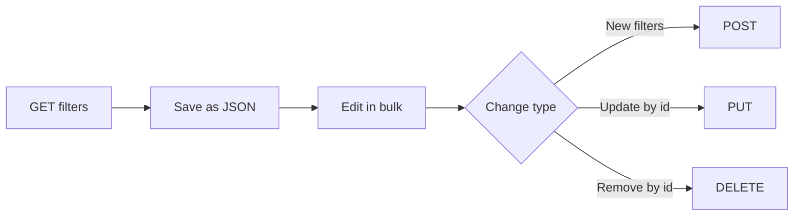

# Bulk Filters API Guide

*Documentation sample: REST API guide, Conviva Connect*

> **In one line:** a task-based guide that teaches analytics administrators to view, create, modify, and delete hundreds of saved filters through a REST API instead of editing them one by one in the UI.

**My role:** Wrote the guide from scratch, tested every request and response against the API, and reviewed the content with subject-matter experts.

## The challenge

Large customers keep many saved filters that slice their video analytics by content, network, geography, device, and custom tags. Managing them one at a time in the UI is slow and error-prone. The API solves that, but it brings its own learning curve:

- **Nested logic.** Filters are trees of rules joined by `and`/`or`, not flat key-value pairs.
- **Two kinds of values.** Some fields only accept preset values (countries, ISPs, ASNs), while others accept free text (asset names, client IDs).
- **Safe bulk changes.** Updates and deletes act on many filters at once, so readers need a workflow that avoids mistakes.
- **Limits and enablement.** Each call handles up to 100 filters, and the API must be turned on by support before first use.

## The approach

### 1. Validate access before anything else

The guide starts with a single test request that lists the available filter fields. Readers confirm their credentials and that the API is enabled before they touch real data. A status-code table follows, so any failure has an explanation.

### 2. Organize by task, not by endpoint

Instead of a flat endpoint reference, the guide is built around what administrators actually want to do. Each HTTP method gets its own scenario with real-world examples:

| Task | Method | Example scenarios |
| --- | --- | --- |
| View filters | `GET` | Look up preset values (such as cities), list filters by creation date, return the first *n* filters |
| Create filters | `POST` | Create many filters from one JSON file |
| Modify filters | `PUT` | Rename filters in bulk; enable a feature across many filters |
| Delete filters | `DELETE` | Remove many filters by ID |

### 3. Teach a safe round-trip workflow

Every write operation starts from a read. Readers export existing filters, edit the JSON, and send it back, so they always work from the real current state:



The guide also covers how `PUT` behaves: it merges new values into the existing filter instead of replacing it. That one detail prevents accidental data loss.

### 4. Make nested rules readable

The rule structure is the hardest part of the API, so the guide shows it with complete, copy-ready request bodies. A simplified illustration of the shape:

```json
[
  {
    "name": "Live sports on mobile",
    "category": "CONTENT",
    "enabled": true,
    "rules": {
      "op": "and",
      "rules": [
        { "field": "Asset Name", "op": "contains", "value": "Live" },
        { "field": "Tag", "key": "genre", "op": "contains", "value": "sports" }
      ]
    }
  }
]
```

*(Illustrative values, written for this portfolio.)*

### 5. Pair every request with its response

Each scenario shows the exact request and the response it returns, so readers can check their results line by line. The lookup endpoints (cities, countries, ISPs, tags, and so on) are documented with a search pattern, so readers can find valid preset values before they build a rule.

## Testing and review

- Ran every documented request against the API and captured the actual responses for the examples.
- Checked each status code and limit against real API behavior.
- Reviewed with engineering SMEs for accuracy of the rule schema, merge behavior, and limits.

## Skills demonstrated

- **API documentation:** REST methods, query parameters, JSON request bodies, response formats, and status codes.
- **Hands-on testing:** examples verified against the API, not copied from a spec.
- **Task-based structure:** content organized around user goals, with a safe workflow for bulk operations.
- **Explaining complex structures:** nested boolean rules made understandable through complete examples.
- **SME collaboration:** technical review to confirm accuracy before publishing.

---

*This summary describes publicly available documentation. Product names and content belong to Conviva.*
