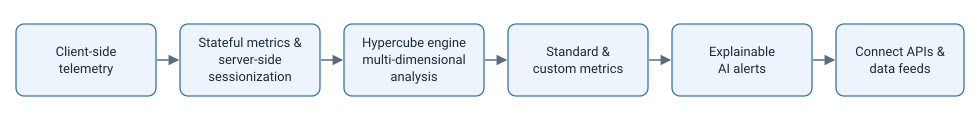

# Explaining a Digital Intelligence Platform

*Documentation sample: product overview page, Conviva Docs*

> **In one line:** a single overview page that explains how a real-time analytics platform turns client-side telemetry into metrics, root-cause analysis, AI alerts, and data APIs — written for readers who range from product managers to data engineers.

**My role:** wrote and structured the page, created the diagrams and example tables, coordinated SME review and on-going updates.

## The challenge

The platform has several hard-to-explain parts that only make sense together: session-level metrics computed while sessions are still running, a multi-dimensional analytics engine, custom metric building, AI-driven alerts, and APIs for getting data out. Readers arrive with different questions:

- **Product and business teams:** what makes this different from the observability tools we already use?
- **Analysts:** which metrics come out of the box, and can I define my own?
- **Engineers:** how do I get the data into our own systems?

The page had to answer all three without becoming a reference manual for each component.

## The approach

### 1. Lead with the differentiator

The page opens by contrasting the platform with traditional observability. Those tools work bottom-up from logs and traces, or measure performance separately from user impact. This platform starts from real user experience and works toward the root cause. Readers get the "why should I care" before any mechanics.

### 2. Follow the data, start to finish

The sections follow the order the data actually moves through the platform, so each concept builds on the one before it:

| Section | Reader question it answers | How it's shown |
| --- | --- | --- |
| Stateful metrics and server-side sessionization | Why real-time, in-session metrics matter | Table mapping app issues to metrics and root-cause dimensions |
| Hypercube engine | How it finds patterns across huge data sets | Drill-down screenshots, from a spike to the page URL behind it |
| Standard and self-defined metrics | What's measured out of the box, and what I can build | Metric screenshots for apps (DPI) and video (SEI); Metric Builder overview |
| Explainable AI-driven insights | How problems surface without manual digging | Annotated alert showing baseline, deviation, and impacted users |
| Connect APIs and data feeds | How the data reaches my own tools | List of real-time, historical, session, and feed options |

### 3. Show, don't just tell

Every abstract claim is paired with a concrete artifact. "Stateful metrics" comes with a table of real app issues (slow startup, crashes, slow API calls) and the metrics that catch them. "Multi-dimensional analysis" comes with a drill-down sequence. "AI alerts" comes with an actual alert and its key markers.

### 4. Overview here, depth elsewhere

The page explains each component just far enough to understand how it fits. It then links to the product-specific docs (app and video overviews, metric dictionaries, AI alert guides, developer APIs) instead of repeating them. Collapsible sections and an "On this page" menu let each type of reader jump straight to their part.

## Skills demonstrated

- **Information architecture:** structuring a multi-component platform as one end-to-end story.
- **Audience analysis:** serving business, analyst, and engineering readers on a single page.
- **Technical explanation:** making concepts like server-side sessionization and multi-dimensional analysis concrete with worked examples.
- **Docs-as-a-system thinking:** a hub page that routes readers to deeper references instead of duplicating them.

---

*This summary describes publicly available documentation. Product names and content belong to Conviva.*
