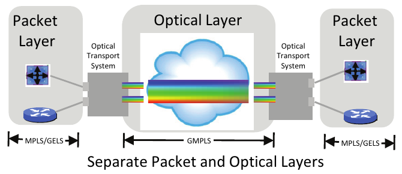
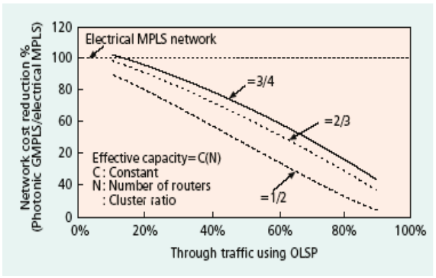
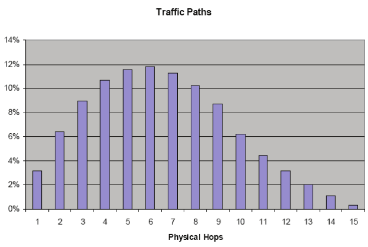
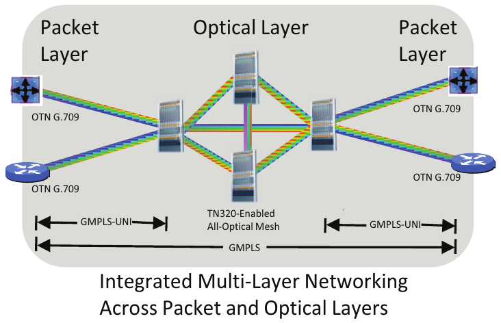
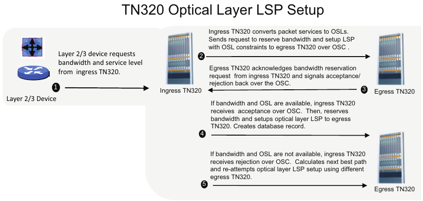
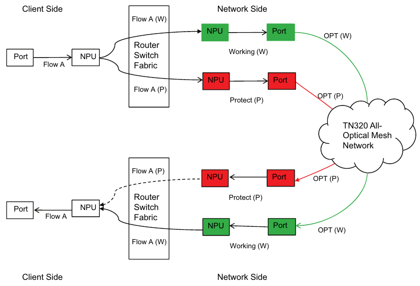
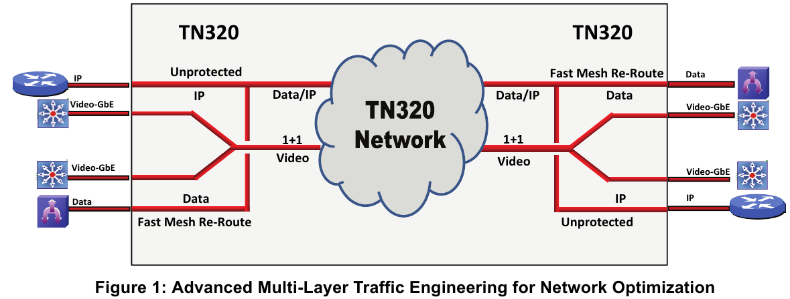

# TN320 Multi-Layer Networking

*Writing sample: technical white paper · Rich Slogar · Taseon Inc., 2008*

> **About this sample:** A technical white paper written for telecom carriers evaluating integrated packet and optical networks. It explains the business case and the technical architecture for Taseon's TN320 multi-layer networking solution, from capacity economics to GMPLS control-plane signaling and protection switching. Taseon Inc. is no longer in business; the paper is reproduced here as a writing sample. Original content © 2008 Taseon Inc.

---

Multi-layer networking is an emerging area of interest for carriers worldwide, especially with the significant potential impact it can have in reducing capex and opex spending, while also simplifying network operations. Taseon is pioneering this exciting new area with unique innovations in its TN320 solution. TN320 integrated multi-layer networking innovations include:

- Integrated packet and optical layer provisioning using a standardized GMPLS control plane.
- Intelligent mapping of packet services on optical LSPs for an optimized optical layer.
- Synchronized protection switching across packet/optical layers to improve network reliability.
- Optical layer resource alignment with packet layer service revenues and profits.

## Divergent Packet Service and Optical Backbone Networks

Traditional optical backbone networks carry multiple services such as voice, video, and Internet over multiple Layer 1/2/3 protocols (SONET/SDH, Ethernet and IP) across WDM transport networks through ring, multi-ring, and point-to-point topologies. While these optical networks carry diverse packet payloads, little or no service or transport intelligence is shared between the packet and optical domains. Packet service and optical transport technologies co-exist throughout the network; yet each technology functions independently with disparate forwarding and control mechanisms as well as independent protection schemes. To meet the growing demands for bandwidth-intensive packetized business and consumer services, multi-service optical backbones are evolving toward a convergence of packet, MPLS, and WDM backbone technologies.

While Generalized Multi-Protocol Label Switching (GMPLS) has emerged as a leading framework for the confluence of packet and wavelength switching across optical networks, implementations of this standard have not led to shared intelligence between the optical transport and packet service layers.

For example, DWDM transponders typically reside in the optical transport system, detached from the packet layer services. Traffic flows from a gray interface on a packet layer system to a gray interface on an optical networking system, and then onto a colored interface on the optical layer system. This interconnection between the packet layer and optical layer systems creates a roadblock to the two layers interacting with each other. Further, current methods for integrating packet and optical network in peer and overlay topologies either compromise the integrity of the routing and optical networks or significantly burden network capacity with replicated connection and traffic processing.

In divergent packet and optical networks, route calculation across the packet and optical domains is time intensive, resulting in prolonged switching and recovery times. Furthermore, without traffic prioritization or service level enforcement across the two layers, low-revenue traffic flows (Internet) are allowed to consume large portions of the backbone capacity. This lowers the overall cost effectiveness and revenue potential of the optical transport network.

## Today's Challenge

As carriers migrate their packet and optical networks to converged next-generation integrated networks, advanced packet and optical layer integration needs to be developed utilizing a standard Automatically Switched Optical Network (ASON) architecture and GMPLS compliant control plane. This integration of network layers needs to enable efficient automatic delivery of optical transport, while seamlessly unifying the packet and optical layer service levels and protection schemes.

> **Integrated Packet/Optical Networking**
> - Align network costs with service revenues.
> - Increase efficiency of provisioning schemes, eliminate over/under provisioning.
> - Enable intelligent optical by-pass and dynamic multi-layer traffic engineering.
> - Synchronize link state and recovery schemes to support multi-layer protection switching.
> - Map packet services to optical service levels.

Several key requirements driving the need for multi-layer networking are:

- Alignment of network costs with the revenue and margins generated by network services.
- All-optical bypass in IP-over-Optical networks for cost-effective scalability of backbone networks.
- Synchronized protection switching across packet and optical layers to improve network reliability.
- Advanced multi-layer traffic engineering to improve network efficiency and future proof the network.

The economy of aligning network costs with the revenue and margins generated by the network services is especially significant as low margin Internet traffic becomes the predominant type of traffic in optical backbones.

A simple optical network scenario with 100 wavelength capacity can be used to demonstrate the value of aligning revenue with resource deployment in optical layer networks. In this example, 60% of the traffic is low revenue Internet traffic, while 40% is high revenue voice services. Using separate packet and optical networks connected without intelligent integration, all traffic through the optical network receives the same high-level 1+1 protection. This results in 40 optical paths for voice (20 working, 20 protect) and 60 optical paths for Internet (30 working, 30 protect)—50 in-service wavelengths.

Using an integrated packet and optical network with 100 wavelength capacity, a similar traffic mix of 60% low revenue Internet traffic and 40% high revenue voice services can be optimized for cost/revenue alignment. Based on intelligent service provisioning, only the 20 optical paths for voice receive high-level 1+1 protection. The lower priority Internet traffic is transported through the optical network unprotected.

| | Divergent Packet and Optical Networks | Integrated Packet and Optical Networks | Change |
| --- | --- | --- | --- |
| Network capacity | 100 wavelengths | 100 wavelengths | |
| Ratio of Internet and voice traffic | 60/40 | 60/40 | |
| Service selection | None. All 1+1 protected | Voice 1+1 protect, Internet unprotected | |
| Optical paths for voice | 40 (20 working, 20 protect) | 40 (20 working, 20 protect) | |
| Optical paths for Internet | 60 (30 working, 30 protect) | 60 (60 unprotected) | **+100%** |
| In-service wavelengths | 50 | 80 | **+60%** |

At full capacity, the result is 40 optical paths for voice (20 working, 20 protect) and 60 optical paths for Internet (60 unprotected)—80 in-service wavelengths, a 100% increase in Internet capacity and a 60% increase in revenue services. Alternatively, an integrated packet and optical network with 20 wavelengths of 1+1 protected voice traffic and 30 wavelengths of unprotected Internet traffic requires a wavelength capacity of 70 wavelengths, a 30% reduction in capital expenditure at the optical layer.

Another trend identified by carriers in the progression toward integrated packet and optical networks is the requirement for intelligent optical bypass. Intelligent optical bypass allows traffic to pass through intermediate network nodes all-optically, without electrical processing. The significant growth in backbone traffic is expected to continue to increase the electronic processing capacity requirements of core routers, a substantial increase in the cost of the network. Implementing intelligent all-optical bypass at intermediate nodes, such that traffic is processed electronically only at the ingress and egress points, significantly increases the scalability of core routers, while reducing the overall cost of the network.

Researchers at NTT Communications conducted a detailed study on the cost effectiveness achieved in such an architecture by using a photonic GMPLS router based network (IP router with DWDM interfaces and a wavelength cross connect integrated with a GMPLS control plane).[^1] Avoiding electronic processing at intermediate IP routers, cost reductions were more than 60% as the majority of traffic at any node was transit traffic. NTT's research showed that all-optical cut-through was applicable for 60%-70% of backbone traffic. As the optical backbone traffic grows, the need for intelligent all-optical bypass increases to minimize packet processing at intermediate core nodes.

*Source: NTT Communications study.[^1]*

Another study by British Telecom confirmed the value of optical bypass by measuring the number of physical hops on the optical traffic paths.[^2] The data verified that the majority of optical paths pass through a significant number of intermediate nodes (approximately 70% of the traffic paths required 4 or more physical hops). This confirms that avoiding electrical processing at intermediate nodes is an important factor in the development of next generation multi-layer networks. Further, this study also discussed the expected traffic growth patterns of BT's network and concluded that an intelligent all-optical mesh network with all-optical bypass at core nodes is the preferred network architecture.

*Source: British Telecom study.[^2]*

True multi-layer networking across the packet and optical layers must also evolve to accommodate intelligent provisioning across packet and optical layers, i.e., dynamic multi-layer traffic engineering. Packet services rely upon Quality-of-Service (QoS) mechanisms such as buffering, queuing, latency mitigation based on ToS/CoS, VLAN IDs and MPLS labels to implement types/classes of service and route prioritization on packet flows. Similarly, optical layer services may define the enforcement of optical parameter thresholds, such as PMD, BER, OSNR, and logical parameters, such as protection schemes and Shared Risk Link Groups (SRLGs), in the form of Optical Service Levels (OSLs), which can be used to specify service levels for optical Label Switched Paths (LSPs).

Different packet services may be mapped into different OSLs. This service mapping across an integrated network builds the foundation for the seamless integration of deployed Layer 2/3 systems with all-optical networks based on multi-layer traffic engineering, preserving the integrity of the routing and optical networks while enhancing the overall cost effectiveness and revenue potential of the optical transport network.

Along with service level integration, a robust network must synchronize multi-layer protection switching across the packet and optical layers to ensure traffic resiliency. This unified recovery process should support 1+1 (sub-50 ms), 1:n, and fast mesh re-route schemes for integrated protection switching.

## Solution: TN320 Multi-Layer Networking

The TN320 system is designed from the ground up to enable intelligent, multi-layer networking across the packet and optical layers. The TN320 system enables an architecture where OTN-enabled DWDM interfaces sit on Layer 2/3 systems, such as IP routers. This IP/MPLS network is intelligently integrated with an all-optical DWDM TN320 network using a standardized GMPLS control plane. The TN320-based multi-layer solution has an overlay architecture where the GMPLS control plane of the optical layer and the MPLS control plane of the packet layer are integrated using GMPLS-UNI.

The TN320 Navigator software provides the intelligence required to enable multi-layer networking with algorithms and software tools for implementing multi-layer traffic engineering based on optical parameters as well as multi-layer protection switching—1+1 (sub-50 ms), 1:n, mesh re-route (sub-500 ms)—across the packet and optical layers.

> **TN320 Multi-Layer Networking**
> - Intelligent traffic integration, i.e., network resources allocated based on traffic value.
> - Efficient provisioning schemes, eliminating over and under resource utilization.
> - Intelligent optical by-pass and dynamic multi-layer traffic engineering.
> - Synchronized link state and recovery schemes to support multi-layer protection switching.
> - Packet services mapped to optical service levels.

Multi-layer 1/2/3 systems, such as IP/MPLS routers, Ethernet/PBT switches, and NG-SONET/SDH systems, with line side DWDM interfaces, can be intelligently integrated into a single, flexible, transparent TN320 all-optical DWDM mesh network.

Furthermore, a TN320 based all-optical network utilizes an all-optical mesh architecture that is incrementally scalable from a base configuration of 4 wavelengths at each TN320 node to a maximum of 320 wavelengths at each TN320 node. This allows the network to be configured in-line with current traffic requirements while minimizing waste of network capacity due to over-provisioning and reducing network congestion due to under-provisioning.

A multi-layer network enabled by the TN320 is relatively simple to deploy and maintain. In order to deploy a packet and optical integrated network that is scalable, flexible and reliable, simply upgrade the currently deployed Layer 2/3 devices from grey interfaces to OTN-enabled WDM interfaces and connect them to the TN320. With a WDM transponder residing on the Layer 2/3 system, the TN320 enables an intelligent integration between the Layer 2/3 systems and an all-optical DWDM mesh network. All TN320 software algorithms and system software are designed for integrating the packet layer with the optical layer (packet-aware and service-aware optical network) and are implemented using the standardized GMPLS control plane.

TN320 software and hardware innovations simplify all aspects of multi-layer networking, including integrated multi-layer provisioning, integrated multi-layer protection switching and advanced multi-layer traffic engineering for network optimization.

This paper discusses the example of an IP/MPLS router connected to a TN320. A similar approach can be used for an Ethernet/PBT Switch, OTN Switch, SONET/SDH digital cross-connect and alien wavelengths from any legacy or third party system.

> **Note:** TN320 all-optical mesh architecture and Advanced Optical Performance Monitoring (AOP) are discussed in separate documents.

## Integrated Multi-Layer Provisioning

The TN320 system integrates seamlessly with currently deployed Layer 2/3 systems to enable an integrated packet-over-all-optical network with integrated multi-layer provisioning. At the packet layer, the Layer 2/3 systems (with OTN-enabled DWDM interface to the TN320) carry traffic configured with various traffic priorities and service levels. At the optical layer, these traffic priorities and service levels are mapped by the TN320 across the optical network and paired with optical Label Switched Paths (LSPs) and Optical Service Levels (OSLs) for optical layer traffic priority and protection schemes. OSLs are a combination of optical layer parameters such as OSNR, BER, PMD and CD and logical parameters such as protection schemes, route diversification and Shared Risk Link Groups (SRLGs). OSLs define the service level of an optical LSP.

### Multi-Layer LSPs

The TN320 solution provides for two ways of setting up multi-layer LSPs. Each method is implemented using the EMS/NMS that can be customized to a particular carrier and a particular Layer 2/3 system vendor. Furthermore, the implementation of each of these methods is based on a standardized GMPLS control plane including GMPLS-UNI, LMP, RSVP-TE and OSPF-TE.

The first method involves first provisioning a lightpath (optical layer LSP) between two WDM-enabled router ports. Then, provision MPLS LSPs as are normally done. The two routers see each other at 1 hop, since the optical LSP is switched all-optically in the TN320 network. This method is simple but static, so there may be some inefficiencies in network utilization at the wavelength level.

The setup sequence, step by step:

1. Layer 2/3 device requests bandwidth and service level from ingress TN320.
2. Ingress TN320 converts packet services to OSLs. Sends request to reserve bandwidth and setup LSP with OSL constraints to egress TN320 over OSC.
3. Egress TN320 acknowledges bandwidth reservation request from ingress TN320 and signals acceptance/rejection back over the OSC.
4. If bandwidth and OSL are available, ingress TN320 receives acceptance over OSC. Then, reserves bandwidth and sets up optical layer LSP to egress TN320. Creates database record.
5. If bandwidth and OSL are not available, ingress TN320 receives rejection over OSC. Calculates next best path and re-attempts optical layer LSP setup using different egress TN320.

The second method involves just provisioning the MPLS LSPs and allowing the automated GMPLS-UNI based signaling between the router and the TN320 to take care of provisioning the optical LSPs. When the service provider initiates this provisioning method, the router makes a request to the TN320 for a lightpath to a particular destination based on the required OSL. The TN320 then calculates, provisions and confirms back to the router the details of the wavelength to which to map the MPLS LSP. This is done simply by indicating the output router port to the router, which in this case corresponds to a particular wavelength which has already been provisioned across the TN320 network. This approach is more dynamic and results in just-in-time provisioning, thereby resulting in a highly optimized network at the optical layer.

From a bandwidth optimization standpoint and MPLS layer perspective, in both the above approaches, when the router maps the MPLS LSPs on the optical LSPs, it does so such that the bandwidth utilization on the optical LSP is maximized. So for example, if an optical LSP is already provisioned and is carrying other MPLS LSPs, but has spare capacity, then the router maps the new MPLS LSP to that same, already provisioned optical LSP, instead of setting up a new optical LSP. Different MPLS LSPs corresponding to different OSLs can be mapped on a single optical LSP. The TN320 system keeps track of the capacity utilization of each optical LSP originating at that node and provides the router with the optical LSP that maximizes the capacity utilization.

Based on the GMPLS compliant control plane, the TN320 transports traffic through the optical network based on the provisioned OSLs. The TN320 is the first solution to provide distributed calculation and provisioning of optical LSPs, for all-optical mesh networks. The Taseon TN320 solution uses a Constrained Shortest Path First (CSPF) based algorithmic schema to calculate lightpaths for optical LSPs in real-time (milliseconds), even allowing inclusion of constraints such as optical parameters (OSNR, PMD, CD, BER) and logical parameters such as protection schemes (1+1, 1:N, fast re-route), and SRLGs. This calculation is done at the ingress node using an information database containing real-time updated information on wavelength availability, node reachability, link availability, and the optical characteristics of each wavelength on each link. This information is distributed and maintained using LMP. Once the lightpath for an optical LSP has been calculated, it is provisioned using RSVP-TE.

The TN320 standardized GMPLS control plane is implemented using a 1 GbE Optical Supervisory Channel (OSC), running on an in-fibre, out-of-band DWDM wavelength. The OSC network (i.e., control plane) is independently routed and maintained from the data plane.

## Integrated Multi-Layer Protection Switching

The TN320 solution supports a robust set of multi-layer protection schemes by working in conjunction with the Layer 2/3 systems. The protection switching is done on an end-to-end path basis similar in concept to path switching in SONET/SDH networks. The signaling is done using the GMPLS control plane. The following protection schemes are implemented on a per MPLS LSP basis (or per Provider Backbone Transport (PBT) connection basis), i.e., on a per flow basis:

- **1+1 protection** Sub-50 ms - Working and Protect Paths are calculated and provisioned and the same flow is replicated on both paths.
- **1:N protection** Sub-50 ms - Working and Protect Paths are calculated and provisioned but only the Working Path carries the live traffic; the Protect Path does not carry any traffic and may be used for low priority traffic that is discarded when a switchover needs to happen.
- **Reroute** 200 ms to 500 ms - Only the Working Path is calculated, provisioned and is carrying traffic. In case of failure, the Protect Path is calculated and provisioned; then, traffic is switched over in real time.

As an illustration of how the TN320 solution helps implement a synchronized multi-layer protection switching paradigm across the packet and optical layers, consider an example of 1+1 protection switching implemented using an IP router with DWDM interfaces connected to a TN320 system. Based on the need to implement 1+1 protection, the TN320 solution calculates and provisions two diversely routed optical LSPs—one Working (W) and one Protect (P)—on two separate wavelengths.

The ingress IP router duplicates the client traffic onto a Working MPLS LSP and a Protect MPLS LSP, which are mapped to Working and Protect optical LSPs respectively. During a normal mode of operation, the egress router drops the traffic flowing on the Protect MPLS LSP. If there is a failure of the Working optical LSP (either a loss of signal or optical degradation beyond a specified threshold of the underlying wavelength), the TN320 network signals the egress router to drop the Working MPLS LSP and switch to the traffic flowing on Protect MPLS LSP. For the TN320 solution, this 1+1 protection switching is consistently accomplished in sub-50 ms time frames.

Further, this multi-layer protection switching is performed using GMPLS-based intelligent aggregation between the IP router and the TN320.

## Advanced Multi-Layer Traffic Engineering for Network Optimization

The TN320 solution provides the ability to implement advanced multi-layer traffic engineering that enables optimal utilization of optical layer resources by intelligently mapping the different services carried by the packet layer to lightpaths associated with Optical Service Levels (OSLs). An OSL is a combination of optical parameter thresholds, such as Chromatic Dispersion, Polarization Mode Dispersion, Bit Error Rate, Optical Signal-Noise Ratio, and logical parameters, such as protection schemes and SRLGs.

### OSL: Logical Parameters

Carriers can define the logical parameters that a lightpath (optical LSP) must meet. Such logical parameters include different types of protection schemes, diverse routing and shared risk group. For example, different protection schema can be used to define OSLs for lightpaths carrying different packet services.

Figure 1 illustrates this concept of advanced multi-layer traffic engineering for network optimization, differentiating multiple kinds of traffic (video, data, and generic IP) and services (IPTV, Enterprise Data, and Internet) across integrated packet and optical layers with different protection schemes.

Traffic is engineered such that high-priority traffic receives the highest level of protection, while other types of traffic receive lower levels of protection:

- **VoIP:** 1+1 protection across packet and optical layers. BER threshold of 10⁻¹².
- **Video Traffic (IPTV services):** 1:1 protection across packet and optical layers. Default thresholds.
- **Data Traffic (enterprise services):** fast mesh re-route protection at the optical layer. The backup lightpath is not pre-calculated or pre-provisioned; it is calculated and provisioned once a failure occurs.
- **Generic IP Traffic (Internet services):** unprotected at the optical layer. If the lightpath fails the optical layer does not do anything; the IP layer handles any backup path calculation and provisioning.

Implementing even such simple traffic engineering across IP and Optical layers in an integrated manner can substantially reduce capex. In most networks, the majority of capex is used to support low revenue traffic (e.g. Internet traffic) that generates only a small portion of the total network revenue.

Multi-layer traffic engineering helps eliminate unnecessary capex by aligning the services with the proper carrier-defined resource requirements at the optical and the packet layers.

### OSL: Optical Parameter Thresholds

Along with logical parameters, an OSL defines a combination of optical parameter thresholds - such as Chromatic Dispersion, Polarization Mode Dispersion, Bit Error Rate, and Optical Signal-Noise Ratio. The Advanced Optical Performance Monitoring (AOP) solution in the TN320 continuously monitors the various optical parameters for each wavelength at each node.

### Layer 2/3 Service to OSL Mapping

Once the OSLs have been defined using logical parameters and/or optical parameter thresholds, carriers can then map various packet layer services to OSLs. As an example, a Layer 2/3 system may support a set of tiered service levels based on VoIP, Internet, generic data and IPTV traffic, as shown in Table 1. In the case of VoIP traffic, the OSL requires that the traffic is 1+1 protected with a BER threshold of 10⁻¹², i.e., if the BER goes above 10⁻¹², a failure occurs and the traffic is switched from the working path to the protect path.

**Table 1: Example Layer 2/3 Service to OSL Mapping**

| Layer 2/3 Service | Service Attribute | Optical Service Level (OSL) | Definition |
| --- | --- | --- | --- |
| VoIP | IP ToS bit 5 | OSL 1 | 1+1 Protection BER threshold 10⁻¹² |
| Data Traffic | MPLS Label XYZ | OSL 2 | Fast Mesh Re-route BER threshold 10⁻¹⁰ |
| Generic IP | MPLS Label 123 | OSL 3 | Unprotected Default PMD, CD, BER thresholds |
| IPTV | MPLS Label ABC | OSL 4 | 1:1 Protection Default PMD, CD, BER thresholds |

## Layer 2/3 System and TN320 Inter-Networking

Layer 2/3 systems integrate with the TN320 using a standardized GMPLS control plane. The implementation of this GMPLS integration can be tailored to meet carrier requirements. One possible implementation involving an IP router and the TN320 is discussed here.

The information exchange between the IP router and the TN320 is done using GMPLS protocols such as LMP, RSVP-UNI, OSPF-TE.

IP router performs the following functions:

- Identifies the required OSL.
- Provisions the LSP or IP connection based on input from TN320.
- Tracks the OTN based optical performance parameters and provides them to the optical layer and management plane.
- Performs switchover/reroute (in coordination with TN320) to implement protection schemes for different LSPs.

The TN320 software:

- Receives the destination address and OSL information from the router.
- Calculates the lightpath that meets the OSL requirements.
- Attempts to maximize the bandwidth utilization of each wavelength.
- Provides the router with the wavelength and port information to which the packet flow needs to be routed.

After receiving the OSL information for the Layer 2/3 device, the TN320 multi-layer networking allows for the real time calculation and provisioning of wavelengths, also called lightpaths or optical LSPs. The TN320 multi-layer networking also helps the Layer 1, Layer 2 and Layer 3 systems intelligently map the respective paths (MPLS LSPs, Ethernet connections, PBT connections, SONET/SDH and ODU connections) to the appropriate wavelength. This intelligent service mapping across the packet and optical layers is fundamental to the implementation of an integrated, intelligent packet-over-all optical network where the DWDM transponder resides on various Layer 1, Layer 2 and Layer 3 systems.

Advanced multi-layer traffic engineering takes advantage of the integration between the packet layer and the optical layer to help optimize the resource utilization at the optical layer. The TN320 multi-layer networking solution provides carriers the tools they need to engineer an integrated packet-optical network as they look to efficiently support the diverse mix of fast-growing packet services.

## Summary

Multi-layer networking is an emerging area of interest for carriers worldwide, especially with the significant potential impact it can have in reducing capex and opex spending, while also simplifying network operations. Taseon is pioneering this exciting new area with unique innovations in its TN320 solution.

The TN320 system is designed from the ground up to enable intelligent, multi-layer networking across packet and optical layers. The TN320 system integrates seamlessly with currently deployed Layer 2/3 systems to enable an integrated packet-over-all-optical network.

WDM signals from OTN-enabled WDM interfaces on Layer 2/3 and legacy systems are seamlessly carried over a TN320-enabled all-optical network. TN320 Navigator software uses GMPLS-UNI, LMP, RSVP-TE and OSPF-TE to provide standards-based integration between packet (IP router) and optical (TN320) layers.

Innovations and benefits of TN320-enabled multi-layer networking include:

- Integrated packet and optical layer provisioning using a standardized GMPLS control plane.
- Intelligent mapping of packet services on optical LSPs for optimal optical layer resource utilization.
- Optical layer resource alignment with the revenues and profits generated by packet layer services.
- Synchronized protection switching across packet and optical layers to improve network reliability.

As multi-layer networking is an emerging technology, Taseon has continuous efforts underway with IP router vendors and Tier-1 telecom carriers to continuously define and improve various aspects of the integrated management plane and control plane.

---

[^1]: GMPLS-Based Photonic Multilayer Router (Hikari Router) Architecture: An Overview of Traffic Engineering and Signaling Technology, *IEEE Communications Magazine*, March 2002.
[^2]: Evolving Optical Networks to Reduce the Total Cost of Ownership. Paye, Davey, Lord. *9th International Conference on Transparent Optical Networks*, July 2007.
